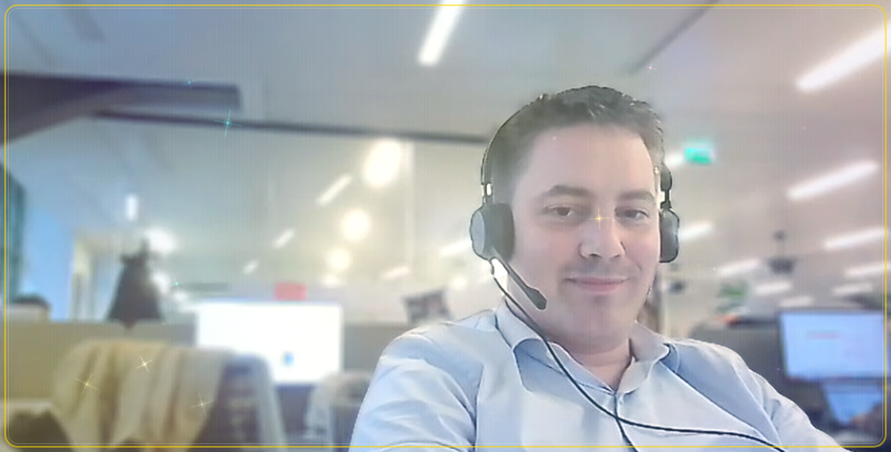
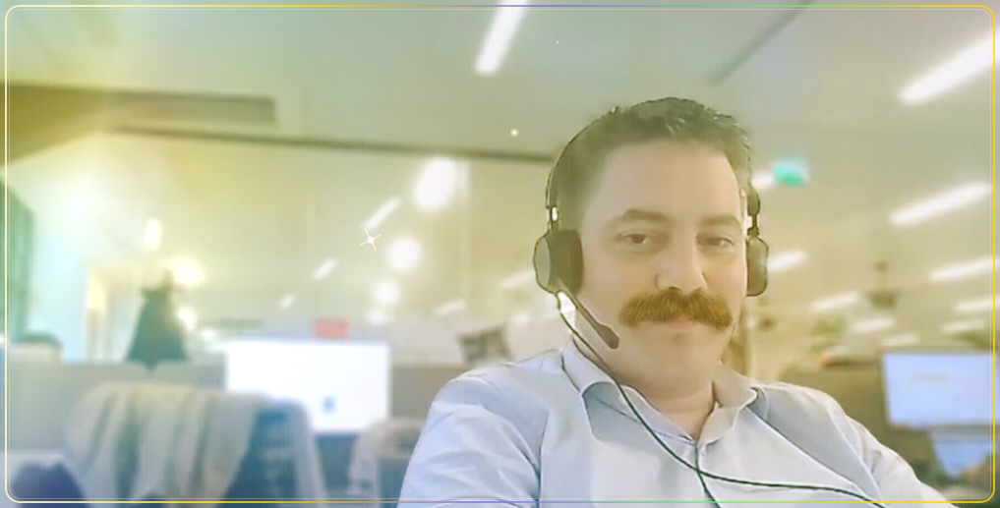
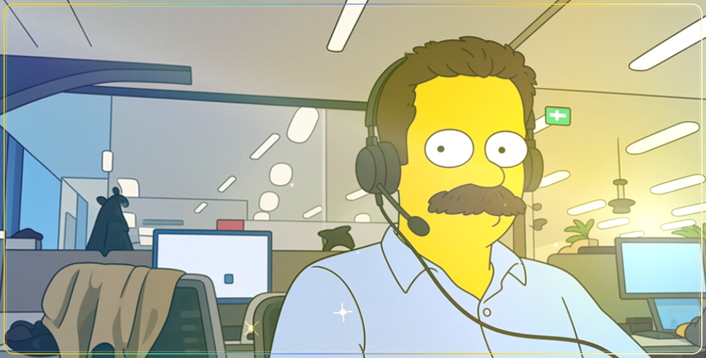
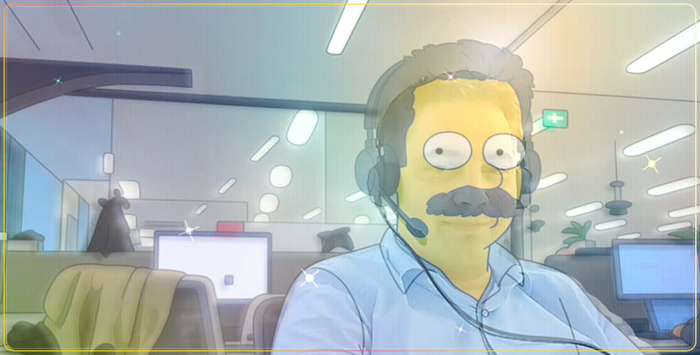

# GoldCard (`v1.0.0` — `cloud.orbital8.gold_card`)

Application mobile native **Flutter (Android & iOS, moteur Impeller 60–120 FPS, Dart Sound Null Safety strict)** plein écran verrouillée en format **Paysage (`Landscape`)** reproduisant une **carte collector brillante métallique irisée à composition lenticulaire 3 images** pilotée par l'**accéléromètre matériel à 60 Hz**.

- **Téléchargement APK / AAB Release `v1.0.0` :** [GitHub Releases (`v1.0.0`)](https://github.com/orbitalstorm/goldcard/releases/tag/v1.0.0)

---

## Aperçu Visuel (Format Paysage Plein Écran `1017 × 517`)

| État | Capture |
| :--- | :--- |
| **01. Écran noir initial (`#000000`) & bouton flottant `"ready"` (*Game Juice*)** |  |
| **02. Composition centrée (`Front.png` 100 % — sans moustache)** |  |
| **03. Inclinaison horizontale gauche (`Left.png` — photo avec moustache + diffraction Or/Émeraude)** |  |
| **04. Inclinaison horizontale droite (`Right.png` — Simpsons avec moustache + diffraction Cyan/Or)** |  |
| **05. Blend lenticulaire horizontal intermédiaire + inclinaison verticale 2D irisée** |  |

---

## Architecture & Séparation Optique des Axes

1. **Écran d'accueil sur fond noir pur (`#000000`) & bouton flottant `"ready"`** :
   - Au démarrage (`CardAppPhase.waitingReady`), l'application affiche un écran noir absolu (`#000000`) centré sur le bouton flottant `"ready"`.
   - L'appui sur `"ready"` déclenche `calibrateZeroPoint()` (capturant l'inclinaison courante du téléphone comme point zéro `(0, 0)`) puis un fondu fluide de `0.85 s` (`CardAppPhase.fadingIn` -> `CardAppPhase.activeComposition`).
2. **Composition Lenticulaire 3 Images (`assets/images/*.png` — `1017 × 517`)** :
   - Gouvernée **exclusivement** par l'inclinaison sur l'axe horizontal (`horizontalTilt` $\in [-1.0, +1.0]$) via `GoldCardEngine.computeLenticularWeights` :
     - `horizontalTilt < 0` : fondu *smoothstep* de `Front.png` vers `Left.png` (portrait photo bureau avec moustache).
     - `horizontalTilt == 0` : `100 %` `Front.png` (portrait photo bureau sans moustache).
     - `horizontalTilt > 0` : fondu *smoothstep* de `Front.png` vers `Right.png` (portrait cartoon style Simpsons avec moustache).
   - L'inclinaison verticale (`verticalTilt`) a **strictement zéro impact** sur les poids lenticulaires.
3. **Revêtement Métallique Irisé Collector (`IridescentFoilState`)** :
   - Gouverné simultanément par **l'inclinaison horizontale ET verticale** (`horizontalTilt`, `verticalTilt`) via `GoldCardEngine.computeIridescentFoilState` :
     - Déplacement 2D du point spéculaire `specularCenter`,
     - Rotation du faisceau métallique brossé anisotrope `foilAngleRadians`,
     - Déphasage chromatique multi-bandes (Or 24K, Champagne, Rose Holographique, Cyan Électrique, Violet Prisme, Émeraude) `iridescentPhase`,
     - Résonance angulaire des 72 micro-paillettes collector pré-allouées.

---

## Structure du Projet

- `lib/models/gold_card_models.dart` : Modèles immuables (`CardAppPhase`, `LenticularBlendWeights`, `IridescentFoilState`, `GoldCardSnapshot`).
- `lib/engine/gold_card_engine.dart` : Moteur physique & optique 60–120 Hz (`GoldCardEngine`), calibration point zéro, filtre passe-bas exponentiel (`1 - exp(-dt * 14.0)`) et zone morte douce (`0.025`).
- `lib/painters/gold_card_lenticular_painter.dart` : Décodage GPU `GoldCardSprites` et rendu `GoldCardLenticularPainter` sans allocation lourde ni `saveLayer` plein écran.
- `lib/main.dart` : Écran noir initial, bouton flottant `"ready"` à *Game Juice* (lévitation, liseré holographique, biseau 3D, Squash & Stretch tactile, haptique) et fondu vers la composition plein écran.
- `android/app/src/main/kotlin/cloud/orbital8/gold_card/MainActivity.kt` & `ios/Runner/AppDelegate.swift` : Verrouillage paysage plein écran et projection 60 Hz de l'accéléromètre dans le repère de l'écran Paysage (`ROTATION_90` / `ROTATION_270` & `landscapeLeft` / `landscapeRight`).
